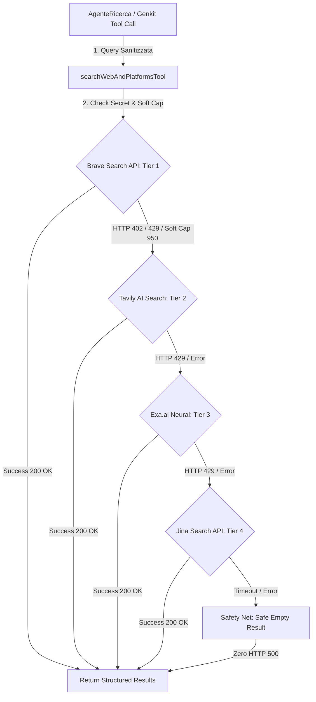
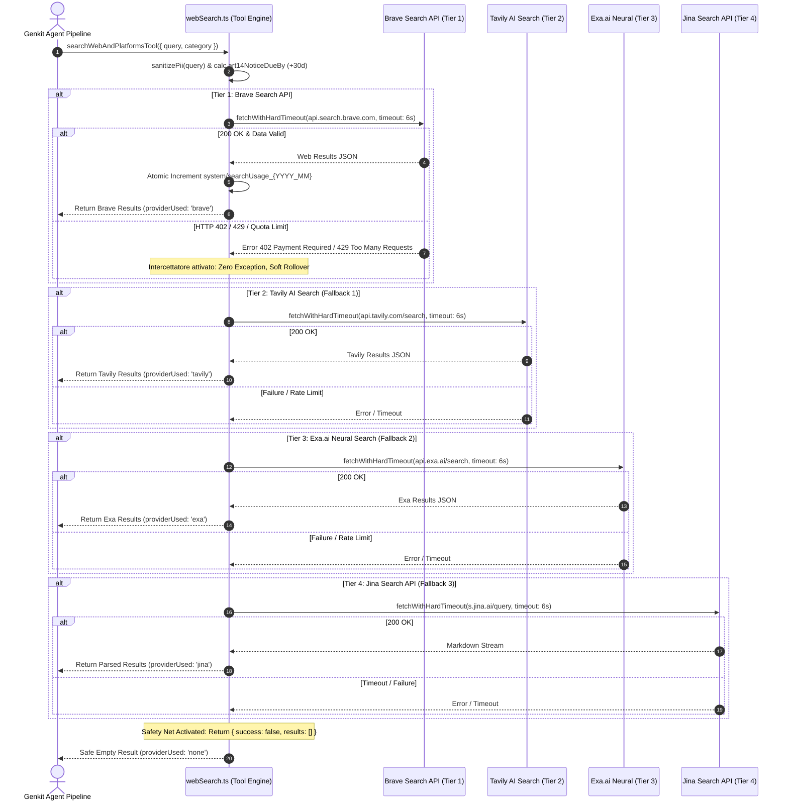
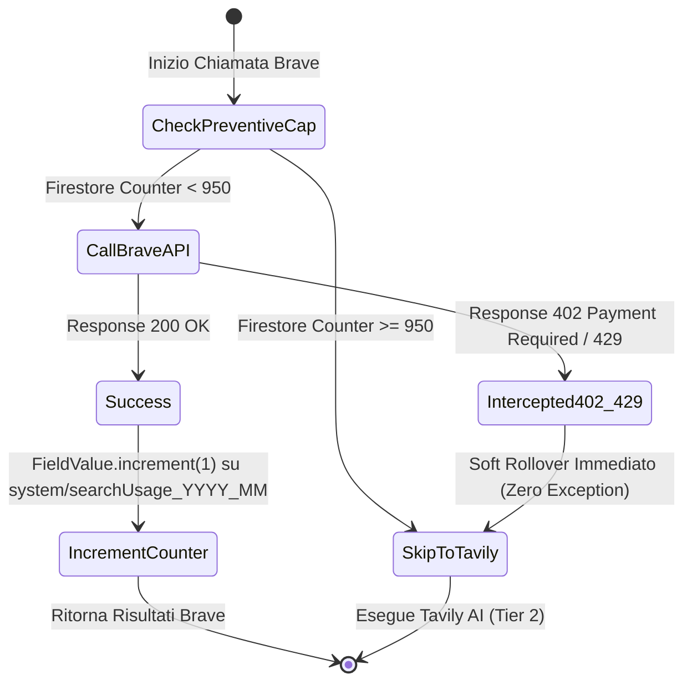
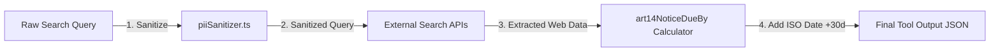

# 🏛️ OpsFlow — Architectural Flow 04: Backend Web Search Engine & Cost Governance

> **Componente:** Web Research Engine, Multi-Provider Fallback Chaining & Double Cost Protection  
> **Tecnologie:** Genkit (`webSearch.ts`), Firebase Cloud Functions Gen 2, GCP Secret Manager  
> **Standard:** Double Cost Guard (Hard Limit $5 + HTTP 402/429 Interceptor + Rolling Quota Guard), GDPR Art. 14 (§3, §5 AGENTS.md)  
> **Stato Documento:** Definitivo — Principal Architecture Approved

---

## 📌 1. Panoramica del Motore di Ricerca

Il motore di ricerca web di **OpsFlow** (`opsflow-functions/src/tools/webSearch.ts`) è progettato per garantire **3.400+ ricerche mensili ad alta accuratezza a costo € 0,00**, azzerando totalmente qualsiasi rischio di errore `HTTP 500` (Zero Crash Guarantee) o addebito incontrollato sulla carta di credito del titolare del SaaS.



---

## ⛓️ 2. Architettura della Catena Multi-Provider (Tier 1 ➔ Safety Net)

### Sequence Diagram: Chaining Sequenziale con Timeout e Fallback



---

## 🛡️ 3. Meccanismo Double Cost Guard su Brave Search API

Per bilanciare lo sfruttamento dei **$5.00 di credito promozionale mensile** di Brave Search API (~1.000 ricerche/mese) ed eliminare qualsiasi rischio di addebito finanziario, l'architettura applica una **doppia barriera di protezione**:



1. **Barriera 1 — Dashboard Brave (Hard Limit $5.00):**  
   Configurazione portale sviluppatori con **Monthly Spending Limit = $5.00** e **Auto-Recharge = OFF**. Al superamento del budget promozionale, l'API Brave rifiuta le chiamate restituendo `HTTP 402` o `HTTP 429` anziché prelevare denaro dalla carta.
2. **Barriera 2 — Backend Interceptor & Counter (`webSearch.ts`):**
   - Intercettazione esplicita degli status `402` e `429`: la funzione restituisce `null` istantaneamente facendo scivolare l'esecuzione su Tavily AI senza rilanciare eccezioni (`throw`).
   - Contatore mensile preventivo su Firestore (`system/searchUsage_{YYYY_MM}`) incrementato atomicamente con `FieldValue.increment(1)`. Raggiunte le 950 chiamate, OpsFlow smette preventivamente di invocare Brave.

---

## ⚖️ 4. GDPR Compliance (Art. 14) & PII Sanitization

### Privacy-by-Design Workflow



- **Sanitizzazione Preventiva:** Ogni query di ricerca viene filtrata da `piiSanitizer.ts` prima dell'uscita verso le API esterne per rimuovere nomi propri, email o codici identificativi (GDPR Art. 32).
- **Tracciamento Informativa GDPR Art. 14:** Rispondendo a requisiti normativi sull'estrazione dati dal web, ogni risultato restituisce il parametro ISO `art14NoticeDueBy` calcolato esattamente a **+30 giorni** dall'estrazione.

---

## ⚙️ 5. Configurazione Infrastrutturale Cloud Functions (Cloud Run 2nd Gen)

Per prevenire timeout, blocchi di memoria o addebiti inutili su istanze inattive, la Cloud Function `chatWithAgent` è configurata secondo i parametri ottimali di governance GCP (§5 AGENTS.md):

| Parametro Cloud Run | Valore Impostato         | Motivazione Architetturale                                                                    |
| :------------------ | :----------------------- | :-------------------------------------------------------------------------------------------- |
| `region`            | `europe-west1`           | Zero costi di egress verso il database Firestore (stessa regione)                             |
| `memory`            | `1GiB`                   | Garantisce 1 vCPU completa a Cloud Run (elimina il boot timeout su container healthcheck)     |
| `timeoutSeconds`    | `120`                    | Consente catene di ricerca multi-turn (Brave/Tavily) e formattazione fogli senza interruzioni |
| `minInstances`      | `0`                      | **Scale-to-Zero:** Costo € 0,00 durante i periodi di inattività                               |
| `maxInstances`      | `10`                     | Hard-Cap per contenere i costi totali sotto il budget target                                  |
| `secrets`           | `[BRAVE_SEARCH_API_KEY]` | Iniezione sicura da GCP Secret Manager (Zero secrets in `.env` di produzione)                 |

---

## 🛡️ 5. Connessione con l'Agentic Control Plane (Flow 07)

I risultati restituiti dal search engine costituiscono il fulcro della pipeline di sicurezza e ottimizzazione costi del Control Plane (§5, §14 AGENTS.md):

### 5.1 Cache Deterministica SHA-256 a 72h & Policy TTL Nativa (Budget Lockdown)

Prima di inoltrare la richiesta a Brave Search o Google Search:

1. Viene calcolato l'hash crittografico **SHA-256** della stringa di ricerca normalizzata (lowercase, trim).
2. Viene interrogata la collezione Firestore `tenants/{tenantId}/webSearchCache/{queryHash}`.
3. Se il documento esiste ed è stato creato meno di 72 ore fa, il payload viene restituito istantaneamente (**0 ms latenza di rete, zero addebiti API**).
4. Se la cache è assente o scaduta, viene eseguita la query live e il risultato viene persistito valorizzando il campo `expiresAt = Timestamp.fromDate(new Date(Date.now() + 72 * 3600 * 1000))`.
5. **Policy TTL Nativa Google Cloud:** Per azzerare i costi di storage e prevenire memory leak su Firestore, la cancellazione automatica dei record scaduti è delegata all'engine nativo di Google Cloud:
   ```bash
   gcloud firestore fields ttls update expiresAt --collection-group=webSearchCache
   ```

### 5.2 Throttling Deterministico Brave Search (Prevenzione 429 da Frequenza)

L'API gratuita di Brave Search impone un limite di frequenza di 1 richiesta al secondo (1 QPS):

- Quando un task o un job schedulato (Flow 05) lancia query X-Ray sequenziali (es. per figure specialistiche o competenze multiple), il dispatcher applica un delay obbligatorio di **1.100 ms** (`await sleep(1100)`) tra le chiamate.
- **Protezione Tier 2:** Questo previene l'errore `HTTP 429 Too Many Requests` dovuto a burst simultanei, evitando che il sistema scivoli prematuramente su Tavily (Tier 2) consumando crediti del fornitore di riserva quando la quota mensile di Brave è ancora intatta.

### 5.3 Quota Cap Per-Workspace / Anti-Abuso (Cost Lockdown)

Oltre al contatore globale di sistema (`system/searchUsage_{YYYY_MM}` fissato a 950 chiamate), il runtime impone un massimale per singolo Workspace:

- Prima di inoltrare la richiesta a `webSearchTool`, la Cloud Function verifica il contatore `workspace.searchUsageCount`.
- Per i workspace con piano **Freemium**, il limite è fissato a **50 ricerche/mese**. Al raggiungimento della soglia, la richiesta viene bloccata con un messaggio esplicativo e non genera addebiti verso i provider a pagamento (Tavily/Exa).

### 5.4 Pre-Filtering a Regex a Monte (Pattern Clay.com)

I risultati grezzi non vengono passati integralmente al modello linguistico:

- Un middleware Node.js applica espressioni regolari per estrarre telefoni territoriali (es. `0584`/`0585`), email palesi conformi a RFC 5322 e URL LinkedIn/web normalizzati.
- A Gemini Flash viene passato solo il compendio semantico pre-strutturato, **riducendo i token di input del 40%** e prevenendo allucinazioni di formattazione.

### 5.5 Accumulo nel Ground-Truth Buffer & Alimentazione Gate 2

Tutti gli URL reali e gli snippet informativi scoperti durante le chiamate di ricerca vengono accumulati in memoria nei buffer globali:

- `groundTruthUrlBuffer`: set di URL normalizzati unici, filtrati contro portali generici (`isRootOrGenericPortal`).
- `groundTruthSnippetBuffer`: compendio testuale di titoli e descrizioni per la validazione incrociata delle entità.

Questo buffer è il presupposto per il controllo deterministico di Gate 2: nessun dato può essere salvato su Google Sheets senza corrispondere a un record presente nel buffer.

Per i dettagli completi su Gate 1, Gate 2, Evidence Citation Chips (Dust.tt) e Checkpointing (LangGraph), consultare:  
👉 [07_agentic_control_plane_and_governance_flow.md](file:///home/chif-vas/projects/opsflow/.logicFlow/07_agentic_control_plane_and_governance_flow.md).
