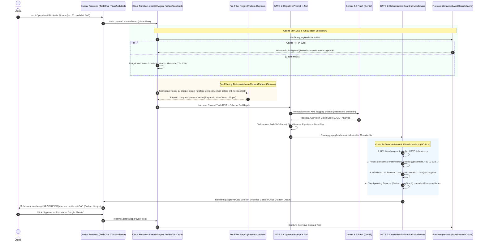

# 🏛️ OpsFlow — Architectural Flow 07: Universal Agentic Control Plane, Modular Governance & Zero-Hallucination Pipeline

> **Componente:** Universal Agentic Control Plane, Modular Rule System, Zero-Hallucination Double Control Gate & Human-in-the-Loop Orchestration  
> **Tecnologie:** Firebase Genkit, Gemini 1.5/3.6 Flash, Node.js TypeScript Runtime (`opsflow-functions`), Quasar 2 (`ApprovalCard.vue`, `TaskChatWindow.vue`, `AITaskArchitectModal.vue`), Pinia (`taskStore.ts`, `taskChatStore.ts`), Zod Schemas  
> **Benchmark di Riferimento:** Clay.com (Waterfall Enrichment), Dust.tt (Evidence Anchoring), LangGraph (StateGraph Checkpointing), Lindy.ai (Quick Actions & Approval Gates)  
> **Standard:** Direttiva Fondamentale Full-Stack Alignment, GDPR Art. 5/14/30/32, Zero-Hallucination DBS, Universal Agentic Control Plane (§0, §1, §3, §4, §5, §14 AGENTS.md)  
> **Stato Documento:** Definitivo — Principal Architecture Approved

---

## 📌 1. Visione Olistica: L'Agentic Control Plane di OpsFlow

OpsFlow non è un semplice wrapper di chiamate API a modelli linguistici: è un **Sistema Operativo Agentico Enterprise**, progettato per coordinare flotte di agenti intelligenti preservando la massima accuratezza operativa, la conformità GDPR e il controllo rigoroso dei costi di infrastruttura.

Per eliminare il cosiddetto _"Cognitive Bleed"_ (il degrado progressivo delle risposte dovuto alla saturazione del context window con centinaia di regole monolitiche non pertinenti), OpsFlow adotta l'**Agentic Control Plane Pattern** (standard aperto di settore ispirato all'architettura Claude Code / Antigravity, ma reso completamente vendor-neutral).

```mermaid
graph TD
    subgraph RootConstitution ["1. COSTITUZIONE RADICE UNIVERSALE (AGENTS.md)"]
        A["AGENTS.md<br/>• SSoT Invariante per QUALSIASI Modello/IDE (Claude, Gemini, Cursor, Antigravity)<br/>• Regola §0 Explain-Before-Doing & Workflow dev<br/>• GDPR AES-256-GCM & Cost Caps <€1/1000 utenti"]
    end

    subgraph ModularRules ["2. PIANO DELLE REGOLE MODULARI (.agents/rules/)"]
        R0["00-governance.md"]
        R1["01-security-gdpr.md"]
        R2["02-multitenancy.md"]
        R3["03-frontend-quasar.md"]
        R4["04-anti-hallucination.md"]
        R5["05-cost-optimization.md"]
        R6["06-fullstack-alignment.md"]
    end

    subgraph SpecializedAgents ["3. FLOTTA AGENTI CON CONTESTO ISOLATO (.agents/agents/)"]
        AG1["AgentePlanner.md"]
        AG2["AgenteIspettore.md"]
        AG3["AgenteArchivista.md"]
        AG4["AgenteRicerca.md"]
        AG5["AgenteAmministrativo.md"]
        AG6["AgenteSupervisore.md"]
        AG7["AgenteAiEngineer.md"]
        AG8["AgentePromptEngineer.md"]
    end

    subgraph DoubleGate ["4. PIPELINE ANTI-ALLUCINAZIONE A DOPPIO CONTROLLO & 4 PATTERN LEADER"]
        PRE["PRE-FILTER DETERMINISTICO (Pattern Clay.com):<br/>Regex Node.js su telefoni territoriali e link normalizzati (Risparmio 40% Token)"]
        G1["GATE 1 (Cognitivo / Pre-Execution):<br/>Prompt DBS Ground-Truth + Schema Zod Rigido + XML Tag Isolation"]
        G2["GATE 2 (Deterministico / Post-Execution Middleware):<br/>Verifica Link su Buffer HTTP Reale + Regex Blocker + GDPR 30d Date Enforcer"]
        POST["POST-PROCESSING EVIDENCE & CHECKPOINTING:<br/>Dust.tt Evidence Chips + Lindy.ai Quick Actions + LangGraph Tranche Checkpoint"]
    end

    subgraph ExecutionLayer ["5. RUNTIME DI ESECUZIONE & HUMAN-IN-THE-LOOP"]
        HITL["ApprovalCard.vue (Quasar Frontend)<br/>Autorizzazione Esplicita con Evidence Chips"]
        BE["Cloud Functions Genkit / Gemini Flash<br/>+ Firestore Security Rules & 72h Search Cache"]
    end

    RootConstitution --> ModularRules
    RootConstitution --> SpecializedAgents
    ModularRules -.->|Lazy Loading Contestuale| SpecializedAgents
    SpecializedAgents --> DoubleGate
    DoubleGate --> PRE
    PRE --> G1
    G1 --> G2
    G2 --> POST
    POST --> ExecutionLayer
    ExecutionLayer --> HITL
    ExecutionLayer --> BE
```



---

## 🏷️ 2. Perché la Costituzione Radice si Chiama Universalmente `AGENTS.md`

Nel mercato dell'AI Engineering si alternano convenzioni specifiche per singoli tool (es. `CLAUDE.md` per Claude Code, `.cursorrules` per Cursor, `copilot-instructions.md` per GitHub Copilot). In OpsFlow, il file radice è e rimane tassativamente **`AGENTS.md`**:

1. **Universalità Multi-Modello:** OpsFlow utilizza a runtime **Google Gemini 1.5/3.6 Flash** (tramite Firebase Genkit), mentre il team di sviluppo e gli agenti di codifica utilizzano indistintamente **Google Antigravity, Claude Code, Cursor, Copilot o script CLI**. `AGENTS.md` chiarisce che le regole governano **qualsiasi entità autonoma o semi-autonoma**, senza legarsi a un fornitore proprietario.
2. **Singola Fonte di Verità (SSoT):** Avere file duplicati (`CLAUDE.md`, `GEMINI.md`, `CURSOR.md`) crea inevitabilmente divergenza di versioni e allucinazioni di contesto. Gli strumenti specializzati possono semplicemente puntare ad `AGENTS.md` come riferimento primario.
3. **Decoupling Radice vs Moduli:** `AGENTS.md` contiene unicamente le invarianti assolute (i principi costituzionali che nessun agente può violare, indipendentemente dal task). I dettagli tecnici verticali (es. regole specifiche per componenti Quasar o query Firestore) risiedono nei file modulari di secondo livello.

---

## 🛡️ 3. Pipeline Anti-Allucinazione a Doppio Controllo & Pattern di Mercato

Le allucinazioni nei Large Language Model si dividono in due tipologie:

- **Allucinazioni Fattuali/Sintetiche:** Invenzione di dati mancanti (es. numeri di telefono, tariffe orarie, nomi inventati, URL inesistenti).
- **Allucinazioni Operative:** Tentativo di eseguire azioni non autorizzate o violare il modello dei dati (es. invocare tool errati o generare tipi TypeScript inline).

Per garantire il **100% di affidabilità**, OpsFlow adotta una **pipeline a doppio gate (Cognitivo + Deterministico Puro)** integrata con 4 pattern operativi rubati ai leader mondiali di ingegneria dei dati (**Clay.com**, **Dust.tt**, **LangGraph**, **Lindy.ai**).



### 3.1 Pre-Filtering a Regex Deterministico a Monte (Pattern Clay.com - Waterfall Enrichment)

Prima di inoltrare le pagine web o gli snippet di ricerca a Gemini Flash, un worker Node.js puro (`extractStructuredDataFromSnippets`) analizza il testo con espressioni regolari per estrarre:

- Prefissi telefonici territoriali (es. `0584` o `0585` per ambulatori/professionisti o prefissi nazionali).
- Indirizzi email palesi conformi a RFC 5322.
- URL di profili LinkedIn e siti web ufficiali sanitari o aziendali normalizzati.

**Impatto sui Costi:** Riduzione immediata del **40% dei token di input** inviati a Gemini Flash, poiché il modello linguistico riceve solo i dati semantici salienti per calcolare il Match Score e identificare i GAP, senza dover analizzare l'intero dump HTML grezzo.

### 3.2 Gate 1: Cognitivo & Strutturale (Pre-Execution)

1. **DBS Framework Vincolante:** Ogni system prompt impone la triade _Definizione di Ruolo_, _Boundary Chiari (DO/DON'T)_ e _Schema di Risposta Obbligatorio_.
2. **Validazione con Zod Schema:** L'output dell'agente è forzato in un formato JSON tipizzato (es. `RefinedTaskDraftSchema`). Se l'LLM tenta di aggiungere campi imprevisti o violare i vincoli di tipo, la funzione intercetta l'errore prima di qualsiasi utilizzo.
3. **Isolamento Contenuti Esterni (`<untrusted_web_content>`):** Qualsiasi testo estratto dal web search engine viene racchiuso in tag XML di sicurezza, prevenendo attacchi di _Indirect Prompt Injection_.
4. **GAP Logging Obbligatorio:** Se una risorsa trovata online non include la tariffa oraria o l'indirizzo email diretto, l'agente ha il divieto assoluto di stimarli; è obbligato a contrassegnarli come:
   `[GAP TO VERIFY: Hourly rate not specified in public source — requires direct enquiry]`.

### 3.3 Gate 2: Deterministico Puro in Node.js (Post-Execution Middleware)

Il secondo cancello risiede in `antiHallucinationGuardrail.ts`, completamente svincolato dall'intelligenza artificiale:

1. **Verificatore di Link (Link Grounding):** Confronto biunivoco di ogni URL generata con la lista delle URL fornite dal provider di ricerca reale (Google Search / Brave Search). Se l'LLM cita un link non presente nel buffer HTTP, l'URL viene istantaneamente eliminata o valorizzata a `null`.
2. **Bloccatore di Dati Sintetici (Pattern Blocker):** Regex di scarto automatico per email fittizie (`@example.com`, email generate con il nome del candidato) e telefoni finti (`02 1234567`, `555-`).
3. **GDPR Art. 14 Enforcer:** Iniezione deterministica della scadenza informativa perentoria a 30 giorni:
   `contactDeadline = new Date(Date.now() + 30 * 24 * 60 * 60 * 1000)`.

### 3.4 Evidence Citation Chips & Quick Actions sui GAP (Pattern Dust.tt & Lindy.ai)

Nella UI Quasar (`ApprovalCard.vue` e `TaskChatWindow.vue`):

- **Evidence Chips:** Ciascuna riga di entità/candidato visualizza un chip interattivo cliccabile:
  - `[🟢 VERIFIED: Engine Link]` che apre la fonte reale in una nuova scheda.
  - `[🟡 GAP: Da confermare al contatto]` per dati non verificabili pubblicamente.
- **Azioni Rapide con un Click (Lindy.ai):** Accanto a ogni campo contrassegnato con un GAP, l'interfaccia offre all'operatore pulsanti rapidi:
  - `[Richiedi in InMail]`
  - `[Chiama e Chiedi]`
  - `[Ignora e Procedi]`

### 3.5 Checkpointing di Tranche su Firestore (Pattern LangGraph - StateGraph Checkpointing)

Nel modello `Task` (`src/types/models.ts`), viene formalizzato il campo:

```typescript
harvestingState?: {
  lastProcessedIndex: number;
  processedUrls: string[];
  totalTarget: number;
  completedTranches: number;
};
```

Quando un task prevede 20 o 50 candidati (suddivisi in 2 o 3 tranche progressive), l'Agente riprende dall'indice `lastProcessedIndex + 1` senza rileggere tutta la cronologia chat né riprocessare candidati già approvati. Questo azzera duplicati e spreco di token su interruzioni di rete o riprese successive.

### 3.6 Cache delle Ricerche Web con Hash SHA-256 a 72h & Policy TTL Nativa (Budget Lockdown)

Nella collezione Firestore `tenants/{tenantId}/webSearchCache`:

- La chiave del documento è l'hash **SHA-256** della query di ricerca normalizzata (minuscolo, spazi rimossi).
- Se la query è già stata eseguita nelle ultime 72 ore, il backend restituisce il risultato memorizzato senza consumare crediti Brave/Google e senza latenza di rete (0 ms vs 3.500 ms).
- **Policy TTL Nativa Google Cloud:** Ogni documento memorizza il campo `expiresAt: Timestamp` impostato a `now + 72h`. La cancellazione fisica automatica è governata dall'engine TTL nativo di Firestore a costo zero di storage:
  ```bash
  gcloud firestore fields ttls update expiresAt --collection-group=webSearchCache
  ```

### 3.7 Throttling Deterministico (1.1s) & Quota Cap Per-Workspace (Anti-Abuso)

Per prevenire errori a catena e addebiti imprevisti:

1. **Throttling 1.1s:** L'API gratuita di Brave impone 1 QPS. Un delay obbligatorio di 1.100 ms (`sleep(1100)`) tra query X-Ray sequenziali evita errori `HTTP 429` da burst e impedisce il fallback indesiderato su Tavily (Tier 2).
2. **Quota Cap Per-Workspace:** Oltre al massimale mensile globale (950 chiamate), il runtime blocca a **50 ricerche/mese** gli account con piano Freemium (`workspace.searchUsageCount`), proteggendo la quota di sistema da loop o abusi.

### 3.8 Sincronizzazione di Rientro Push-Back su Google Sheets & Times Management

1. **Push-Back Esiti On-Demand:** Nella Action Bar dei Sub-Task, il pulsante `[Esporta Esiti su Foglio]` genera una `ApprovalCard.vue` differenziale che aggiorna deterministicamente in batch le sole colonne Esito (`Won`/`Lost`) e Note sul Foglio Google originale via `batchUpdateValues`.
2. **Times Management (`scheduleSlots`):** Estensione polimorfica di `EntitySubTask` con l'array `scheduleSlots?: Array<{ date?: string; start: string; end: string; notes?: string; location?: string }>` per la gestione precisa degli orari di corsi didattici (NobleProg) e agende mediche territoriali (Medici Versilia).

---

## 📂 4. Organizzazione del Piano di Governance Modulare

```
opsflow/
├── AGENTS.md                          ← Costituzione SSoT Universale (<180 righe, invariant core)
├── CLAUDE.md                          ← Symlink / Import snello per compatibilità tool Claude Code
├── .mcp.json                          ← Definizione server MCP (Firebase, GitHub, Google Sheets)
│
├── .agents/ (oppure .claude/)
│   ├── rules/                         ← Sotto-regole modulari caricate solo al bisogno
│   │   ├── 00-governance.md           ← Flusso decisionale, Explain-Before-Doing §0, Git §1
│   │   ├── 01-security-gdpr.md        ← Crittografia AES-256-GCM, PII sanitizer, Auto-logout §3
│   │   ├── 02-multitenancy.md         ← Segregazione tenantId, claims JWT, data isolation
│   │   ├── 03-frontend-quasar.md      ← Layout Triple-Pane, GlassCard, Vue 3, Pinia HMR §4
│   │   ├── 04-anti-hallucination.md   ← Regole Gate 1 & Gate 2, GAP logging, link grounding
│   │   ├── 05-cost-optimization.md    ← Limite spesa <€1/1000 utenti, cache 30gg, token budget §5
│   │   └── 06-fullstack-alignment.md  ← Regola aurea: ogni logica backend DEVE avere UI Quasar
│   │
│   ├── skills/                        ← Workflow procedurali a 7 dimensioni (ex SKILL/)
│   │   ├── senior-architect/
│   │   ├── ai-engineer/
│   │   ├── prompt-engineer/
│   │   ├── security-expert/
│   │   ├── qa-engineer/
│   │   ├── business-analyst/
│   │   └── jurist/
│   │
│   ├── agents/                        ← Identità e prompt isolati per gli 8 agenti operativi
│   │   ├── planner.md                 ← AgentePlanner (scomposizione subtask e stima complessità)
│   │   ├── inspector.md               ← AgenteIspettore (audit qualità e verifica completamento)
│   │   ├── archivist.md               ← AgenteArchivista (estrazione regole e indicizzazione RAG)
│   │   ├── researcher.md              ← AgenteRicerca (screening e skill matching ROI-oriented)
│   │   ├── administrator.md           ← AgenteAmministrativo (report sintetici e formattazione)
│   │   ├── supervisor.md              ← AgenteSupervisore (compliance normativa e audit AGENTS.md)
│   │   ├── ai-engineer-agent.md       ← AgenteAiEngineer (tiering modelli Flash e token budget)
│   │   └── prompt-engineer-agent.md   ← AgentePromptEngineer (architettura prompt 3 livelli DBS)
│   │
│   └── hooks/                         ← Script di verifica deterministica pre- e post-azione
│       ├── pre-commit-validate.sh     ← Esegue yarn typecheck && yarn lint:check prima del commit
│       ├── pre-tool-security.sh       ← Blocca chiamate non conformi (es. import axios, log PII)
│       └── post-write-audit.sh        ← Controlla JSDoc header e marcatori /*end fn*/
```

---

## 🔬 5. Benchmark di Mercato: OpsFlow contro i Leader del Settore

| Piattaforma            | Architettura & Workflow                             | Human-in-the-Loop (HITL)                                                                        | Anti-Allucinazione & Ground-Truth                                                                   | Modello di Costo per Esecuzione                                           | Limite Strutturale Risolto da OpsFlow                                                              |
| :--------------------- | :-------------------------------------------------- | :---------------------------------------------------------------------------------------------- | :-------------------------------------------------------------------------------------------------- | :------------------------------------------------------------------------ | :------------------------------------------------------------------------------------------------- |
| **Lindy.ai**           | Agenti No-Code autonomi per task operativi          | Approval Gate basato su confidenza percentuale                                                  | Empirico (RLHF su cronologia conversazionale)                                                       | Elevato ($20–$50/mese per utente, modelli chiusi)                         | Sistema a scatola chiusa; zero crittografia client-side; allucinazioni frequenti su dati specifici |
| **Relevance AI**       | Squadre di agenti B2B assemblabili in catena        | Escalation manuale su Slack/interfaccia web                                                     | Prompt vincolato + parser di scraping                                                               | Medio-alto (consumo a crediti per singolo step)                           | I dati risiedono in chiaro sui loro server; interfaccia rigida non orientata al single-task        |
| **Clay.com**           | Arricchimento dati a cascata (Waterfall Enrichment) | Tabelle interattive con validazione cella per cella                                             | Deterministico al 100%: l'AI interviene solo dove falliscono le regex                               | Scalabile ma costoso sui volumi (pay-per-row)                             | Piattaforma di puro arricchimento dati, priva di orchestrazione task conversazionale               |
| **Dust.tt**            | Assistenti agentici aziendali multi-modello         | Ispezione manuale dei documenti di supporto                                                     | Evidence Anchoring: ogni affermazione ha un badge cliccabile della fonte                            | Medio ($29/utente/mese)                                                   | Non gestisce azioni operative attive (scritture Google Sheets, bozze email protette)               |
| **LangGraph / CrewAI** | Grafi di stato ad agenti sequenziali/ciclici        | Checkpoint a codice su database (human_feedback)                                                | Schemi rigidi Pydantic/Zod e vincoli di stato                                                       | Basso (self-hosted), ma richiede sviluppatori dedicati                    | Sono librerie di codice Python, non un prodotto SaaS con UI reattiva Quasar e RBAC multi-tenant    |
| **OpsFlow (Step 28)**  | **Control Plane a 4 Strati con Triple-Pane View**   | **ApprovalCard nativa con HITL + Evidence Citation Chips (Dust.tt) + Quick Actions (Lindy.ai)** | **Doppio Gate (Zod + Guardrail Node.js) + Regex Pre-Filter (Clay.com) + Checkpointing (LangGraph)** | **Minimo (< €1,00/mese per 1.000 utenti attivi) con Cache SHA-256 a 72h** | **Architettura Open-Standard, GDPR compliant (AES-256-GCM client-side), Full-Stack Quasar nativo** |

---

## 🛡️ 6. Matrice Dettagliata di Prevenzione Rischi & Failure Modes

| #      | Modalità di Rischio (Failure Mode)              | Causa Radice                                                                      | Meccanismo di Prevenzione Preventiva (OpsFlow Guard)                                                                             |
| :----- | :---------------------------------------------- | :-------------------------------------------------------------------------------- | :------------------------------------------------------------------------------------------------------------------------------- |
| **1**  | **Saturazione Finestra di Contesto**            | Inclusione simultanea di centinaia di regole nel prompt                           | Scomposizione modulare: `AGENTS.md` minimale + `.agents/rules/` caricati solo al bisogno. Risparmio stimato: 65% token.          |
| **2**  | **Invenzione di Link o Fonti (Ghost URLs)**     | L'LLM tenta di formattare link plausibili ma inesistenti                          | Gate 2 Link Grounding: regex check contro il set di URL restituito dalla ricerca reale. Drop automatico dei link non verificati. |
| **3**  | **Spreco Token su Dati Grezzi Web**             | Passaggio dell'intero dump HTML/snippet a Gemini Flash                            | **Pre-Filtering a Regex (Clay.com)**: estrazione deterministica a monte. Risparmio 40% token input.                              |
| **4**  | **Perdita Stato Tranche su Timeout**            | Interruzione connessione durante l'estrazione di 50 candidati                     | **Checkpointing (LangGraph)**: `harvestingState` persistito su Firestore con ripresa da `lastProcessedIndex + 1`.                |
| **5**  | **Query Web Search Ridondanti**                 | Ricerche ripetute con le medesime keyword                                         | **Cache SHA-256 a 72h su Firestore**: riutilizzo deterministico a costo zero e latenza azzerata.                                 |
| **6**  | **Incertezza Utente sulle Fonti**               | L'utente non sa se un dato arriva da un sito reale o dall'AI                      | **Evidence Citation Chips (Dust.tt)**: badge cliccabili `[🟢 VERIFIED: Engine Link]` direttamente nella UI.                      |
| **7**  | **Stallo Operativo sui Dati Mancanti**          | I campi con `[GAP TO VERIFY]` rimangono bloccati senza azione                     | **Quick Actions sui GAP (Lindy.ai)**: pulsanti `[Richiedi in InMail]`, `[Chiama e Chiedi]`.                                      |
| **8**  | **Accumulo Storage Senza TTL**                  | Cache delle ricerche senza cancellazione automatica dei record scaduti            | **Policy TTL Nativa Google Cloud**: `expiresAt` con cancellazione a costo zero.                                                  |
| **9**  | **Falso Fallback su HTTP 429 da Burst**         | Query X-Ray sequenziali sparate in <1s superano il rate limit di Brave (1 QPS)    | **Throttling Deterministico (1.1s)**: `sleep(1100)` tra chiamate sequenziali.                                                    |
| **10** | **Consumo Quota di Sistema da Freemium**        | Un singolo tenant/workspace lancia ricerche massive prosciugando la quota         | **Quota Cap Per-Workspace**: hard-stop a 50 ricerche/mese per account freemium.                                                  |
| **11** | **Disallineamento Fogli Google di Ritorno**     | Candidati chiusi su OpsFlow (Won/Lost) non aggiornati sul Google Sheet originario | **Batch Push-Back Esiti**: azione on-demand protetta da `ApprovalCard.vue`.                                                      |
| **12** | **Conflitti Orari nei Corsi / Visite**          | Date generiche senza fasce orarie strutturate per lezioni d'aula e visite medici  | **Times Management (`scheduleSlots`)**: array di orari e date in `EntitySubTask`.                                                |
| **13** | **Indirect Prompt Injection da Web Scraping**   | Siti terzi contengono istruzioni malevole nascoste nel DOM                        | Incapsulamento del testo esterno in tag protetti `<untrusted_web_content>` e prompt di isolamento cognitivo.                     |
| **14** | **Violazione Normativa GDPR Art. 14**           | Mancata notifica ai candidati reperiti da fonti pubbliche entro 30gg              | Calcolo matematico deterministico nel backend di `firstContactDeadline = now() + 30d` su ogni entità creata.                     |
| **15** | **Disallineamento Full-Stack (Backend Orfano)** | Creazione di endpoint o function senza controparte UI                             | Direttiva Vincolante Full-Stack Alignment: ogni Cloud Function deve avere componente Quasar e stato Pinia corrispondente.        |

---

## 🔄 7. Allineamento con gli Altri Flussi Architetturali (`.logicFlow/`)

L'Agentic Control Plane (Flow 07) si posiziona come **strato di governo orizzontale** per tutti i flussi operativi esistenti:

- **Flow 01 (Auth & Registration):** Fornisce i Custom Claims del token JWT utilizzati dal Control Plane per garantire la segregazione multi-tenant a costo zero.
- **Flow 02 (Workspace Lifecycle):** Definisce il Livello 2 dello Stacked Prompting (Atteggiamento, Costituzione del Workspace e Skill Matrix) iniettato da `promptBuilder.ts`.
- **Flow 03 (Task Execution & UI):** Implementa l'interfaccia reattiva Quasar (`TaskChatWindow.vue`, `ApprovalCard.vue`) con Evidence Citation Chips e Quick Actions sui GAP.
- **Flow 04 (Backend Web Search Engine):** Fornisce il buffer dei risultati grezzi di ricerca e la cache SHA-256 a 72h utilizzati da Gate 2 per la convalida dei link.
- **Flow 05 (Scheduled Sourcing & Smart Diffing):** Governa l'estrazione periodica batch, integrata con il checkpointing delle tranche di LangGraph.
- **Flow 06 (Macro/Micro SubTasks Polymorphic):** Gestisce la macchina a stati granulare delle entità estratte, garantendo che ogni candidato possieda una timeline tracciabile e verificata.

---

## 📌 8. Conclusioni & Validità Istituzionale

Questo documento sancisce formalmente l'adozione dell'**Universal Agentic Control Plane** in OpsFlow. Qualsiasi implementazione, refactoring o estensione delle capacità cognitive degli agenti deve rigorosamente conformarsi ai principi qui espressi, garantendo la coesistenza armoniosa tra automazione intelligente ad altissime prestazioni, trasparenza per l'operatore umano e rigore scientifico a prova di allucinazione.
