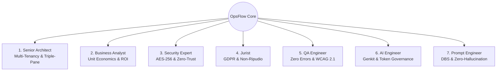

# 🏛️ OpsFlow — Analisi Architetturale, Strutturale e Funzionale Globale

> **Documento:** Analisi Olistica del Progetto OpsFlow  
> **Standard:** [AGENTS.md](file:///home/chif-vas/projects/opsflow/AGENTS.md) & [SKILL/](file:///home/chif-vas/projects/opsflow/SKILL)  
> **Autore:** AI System Architect (Antigravity)  
> **Branch di Riferimento:** `dev`  
> **Data:** 24 Settembre 2026

---

## 🧭 1. Visione, Obiettivi e Valore di Business (SaaS Unit Economics)

**OpsFlow** è una piattaforma SaaS di **Operational Intelligence & Agentic Orchestration** di livello enterprise, progettata per professionisti, agenzie, recruiter e team aziendali.

### Il Problema Risolto

Nelle organizzazioni moderne, i professionisti disperdono fino al 60% del proprio tempo in compiti operativi a basso valore aggiunto ma ad alta intensità manuale:

1. Scouting manuale di profili, lead o fornitori su piattaforme multiple (LinkedIn, Clutch, Malt, portali sanitari, banche dati normative).
2. Copia-incolla ripetitivo di dati su fogli di calcolo Google Sheets.
3. Redazione manuale di bozze di email, solleciti e follow-up.
4. Mancanza di tracciabilità granulare per singolo contatto o risorsa trovata.

### La Soluzione OpsFlow

OpsFlow converte questi flussi in **processi assistiti da Agenti IA Specializzati** governati da una rigorosa politica **Human-in-the-Loop**:

- **Task-as-a-Chat:** Il task non è un record passivo su una Kanban board, ma un'unità conversazionale vivente con timeline, memoria di lavoro e chat interattiva.
- **Human-in-the-Loop Obbligatorio:** Gli agenti elaborano ricerche, estraggono candidati e preparano bozze, ma non eseguono MAI scritture su Google Sheets o invii email senza approvazione esplicita dell'operatore (`✅ Approve` / `❌ Reject` via `ApprovalCard.vue`).
- **Unit Economics ad Efficienza Massima:** Costo totale dell'infrastruttura cloud inferiore a **€ 1,00 / mese per 1.000 utenti attivi mensili (MAU)** grazie al paradigma _Zero-Query RBAC_ (navigazione tramite Custom Claims JWT senza interrogare Firestore) e cache locale resiliente a 30 giorni.

---

## 👥 2. Analisi Olistica Multi-Prospettiva (Le 7 Dimensioni Specialistiche)

In conformità al protocollo definito in [AGENTS.md](file:///home/chif-vas/projects/opsflow/AGENTS.md) §9 e alle direttive contenute nei singoli file della cartella [SKILL/](file:///home/chif-vas/projects/opsflow/SKILL), l'architettura di OpsFlow risponde a sette rigorosi criteri:



### 1. 🏗️ Senior Architect ([SKILL/senior-architect/SKILL.md](file:///home/chif-vas/projects/opsflow/SKILL/senior-architect/SKILL.md))

- **Isolamento Multi-Tenant Rigoroso:** Config-Fenced path obbligatorio su Firestore: `tenants/{tenantId}/workspaces/{workspaceId}/tasks/{taskId}`. Nessuna query aperta o globale ammessa.
- **Triple-Pane UI (NotebookLM Style):** Layout operativo a tre aree coordinate:
  1. _Left Drawer:_ Esploratore workspace, cartelle, stati e membri.
  2. _Canvas Centrale:_ Dashboard dinamica a schede con card pulite in stile foglio di lavoro.
  3. _Right Drawer / Floating Windows:_ Finestre di chat IA indipendenti, trascinabili, ridimensionabili e minimizzabili nella dock.
- **Tipizzazione Rigorosa:** Modelli dati centralizzati in `src/types/models.ts`. Zero tipi inline nei componenti Vue. TypeScript in strict mode.

### 2. 💼 Senior Business Analyst ([SKILL/senior-business-analyst/SKILL.md](file:///home/chif-vas/projects/opsflow/SKILL/senior-business-analyst/SKILL.md))

- **Controllo Costi Infrastruttura:** Target fisso < €1,00/mese per 1.000 MAU.
- **Efficienza Operativa & Riduzione Clic:** La scomposizione automatica del task (tramite `AITaskArchitectModal.vue`) riduce il tempo di onboarding di una commessa da 30 minuti a meno di 2 minuti.
- **Integrità Contabile & Tracciabilità:** Tracciamento automatico delle quote di ricerca web (Brave, Tavily, Exa, Jina) e cronologia esportabile.

### 3. 🛡️ Senior Security Expert ([SKILL/senior-security-expert/SKILL.md](file:///home/chif-vas/projects/opsflow/SKILL/senior-security-expert/SKILL.md))

- **Crittografia Client-Side (AES-256-GCM):** I dati clinici, anagrafici e le note riservate vengono cifrati direttamente nel browser dell'utente (tramite WebCrypto API con chiave Master derivata via PBKDF2) prima della scrittura su Firestore.
- **Anti-IDOR & Firestore Rules:** Impossibilità di accedere a documenti appartenenti a tenant differenti. Ogni operazione valida sia l'autenticazione che il claim `tenantId`.
- **Supply Chain Lockdown:** Divieto tassativo di librerie esterne non certificate (`axios`, `got`, `node-fetch` severamente vietati). Utilizzo esclusivo dell'SDK Firebase ufficiale e fetch nativo con timeout forzati.
- **Safe Logging:** Nessun `console.log` in produzione; sanitizzazione automatica PII (mascheramento email `***@***.com`, rimozione token e secret).

### 4. 🏛️ Senior Jurist ([SKILL/senior-jurist/SKILL.md](file:///home/chif-vas/projects/opsflow/SKILL/senior-jurist/SKILL.md))

- **GDPR Art. 14 (Informativa Indiretta):** Per i contatti recuperati dal web tramite OSINT/sourcing, il sistema calcola e memorizza automaticamente il campo `art14NoticeDueBy` fissato a **+30 giorni** dal recupero del dato.
- **GDPR Art. 30 (Registro del Trattamento & Audit Trail):** Collezione `/audit` a inserimento immutabile (_append-only_), protetta da regole Firestore che impediscono modifiche (`update: false`) o cancellazioni (`delete: false`).
- **Tutela IP & Zero-Training LLM:** Clausola vincolante che impedisce l'invio dei dati del tenant a modelli di training pubblici.

### 5. 🧪 Senior QA Engineer ([SKILL/senior-qa-engineer/SKILL.md](file:///home/chif-vas/projects/opsflow/SKILL/senior-qa-engineer/SKILL.md))

- **Zero Errori Pre-Commit:** `yarn typecheck` e `yarn lint:check` (con strumenti ultra-rapidi Rust-based: `oxlint` e `oxfmt`) devono restituire tassativamente 0 errori e 0 warning.
- **Accessibilità & Design System:** Rispetto degli standard WCAG 2.1 AA e della palette Elite (Royal Navy `#0a2342`, Gold `#c5a065`, Sand `#f9f7f2`).

### 6. 🤖 AI Engineer ([SKILL/ai-engineer/SKILL.md](file:///home/chif-vas/projects/opsflow/SKILL/ai-engineer/SKILL.md))

- **Model Tiering Rigoroso:** Impiego esclusivo di modelli veloci ed economici (`googleai/gemini-1.5-flash` / `gemini-2.5-flash`). Blocco dell'invocazione immotivata di modelli `-pro`.
- **Gestione del Contesto Conversazionale:** Sliding Window limitata agli ultimi 5 messaggi + Rolling Key Points Summary per mantenere il consumo di token costantemente sotto la soglia di budget.
- **Timeout & Failure Resilience:** Configurazione di timeout espliciti sulle Cloud Functions (120s - 300s) e fallimento controllato con messaggi user-friendly senza crash del server.

### 7. ✍️ Prompt Engineer ([SKILL/prompt-engineer/SKILL.md](file:///home/chif-vas/projects/opsflow/SKILL/prompt-engineer/SKILL.md))

- **Framework DBS (Direction, Blueprints, Solutions):** Costituzione operazionale di ciascun Workspace strutturata su 3 assi: Obiettivi Strategici (Direction), Competenze e Tool autorizzati (Blueprints), Regole vincolanti DO/DON'T e Tono di Voce (Solutions).
- **Architecture Stacked Prompting a 3 Livelli:**
  - _Livello 1:_ Identità Base OpsFlow & Regole di Sicurezza/Sanitizzazione PII.
  - _Livello 2:_ Costituzione DBS del Workspace & ID Risorse collegate (Google Sheets / Drive).
  - _Livello 3:_ Contesto contingente del Task & Istruzione Utente sanificata.
- **Zero-Hallucination & Gap Logging:** Se un dato essenziale (es. tariffa oraria o budget) manca nell'input grezzo, l'AI ha il divieto di inventarlo e deve registrarlo come "Punto da Verificare" (GAP Operativo).

---

## 🏢 3. Struttura del Repository e Architettura Full-Stack

Il progetto è organizzato come una monorepo funzionale che separa nettamente il client Quasar (Frontend SPA) dai servizi serverless Firebase (Backend Cloud Functions):

```
opsflow/
├── .logicFlow/                  # 🌐 Single Source of Truth dei Flussi Architetturali
│   ├── 01_auth_and_registration_flow.md
│   ├── 02_workspace_lifecycle_and_setup_flow.md
│   ├── 03_task_execution_and_ui_flow.md
│   ├── 04_backend_web_search_engine_flow.md
│   ├── 05_scheduled_sourcing_and_smart_diffing_flow.md
│   └── 06_macro_task_and_micro_subtasks_polymorphic_flow.md
├── SKILL/                       # 🧠 Skill & Linee Guida di Ruolo (Architect, Jurist, etc.)
├── cheklists/                   # 📋 Piani operativi e roadmap di avanzamento (Step 1 -> 27)
├── firestore.rules              # 🛡️ Regole di sicurezza Firestore Multi-Tenant & Anti-IDOR
├── src/                         # 💻 Frontend Quasar 2 / Vue 3 (TypeScript Strict)
│   ├── boot/                    # Bootstrapping (Firebase init, i18n)
│   ├── components/              # Componenti UI riutilizzabili (Chat, Modal, Card, Dock)
│   │   ├── TaskChatWindow.vue   # Core conversazionale e operativo per task
│   │   ├── ApprovalCard.vue     # Scheda Human-in-the-Loop per autorizzazione azioni
│   │   ├── TaskKeyPointsCard.vue# Sintesi rotante dei punti chiave del task
│   │   ├── AITaskArchitectModal.vue # Scomposizione guidata AI di bozze/email
│   │   ├── AIPromptArchitectModal.vue # Wizard DBS per Costituzione Workspace
│   │   ├── SubTaskEntityModal.vue   # Gestione granulare della singola risorsa/candidato
│   │   ├── AppFloatingWindow.vue    # Finestra fluttuante, trascinabile e ridimensionabile
│   │   └── AppWindowDock.vue        # Barra dock inferiore per finestre minimizzate
│   ├── layouts/MainLayout.vue   # Layout a 3 colonne (Workspace Explorer, Canvas, Chat)
│   ├── pages/                   # File-based routing (index.vue, login.vue, register.vue, invite.vue)
│   ├── stores/                  # Pinia Stores (authStore, taskStore, taskChatStore, etc.)
│   └── types/models.ts          # Centralizzazione di tutti i modelli TypeScript
└── opsflow-functions/           # ⚡ Backend Serverless (Firebase Cloud Functions Gen 2)
    └── src/
        ├── index.ts             # Entrypoint Cloud Functions (Callable, HTTP, Scheduled, Triggers)
        ├── ai/
        │   ├── genkitConfig.ts  # Configurazione Firebase Genkit & Gemini Flash
        │   ├── promptBuilder.ts # Costruttore Stacked Prompting a 3 Livelli (DBS Engine)
        │   ├── chatFlow.ts      # Pipeline conversazionale agentica
        │   └── piiSanitizer.ts  # Middleware di anonimizzazione e sanificazione PII
        └── tools/
            ├── webSearch.ts     # Motore di ricerca a 4 livelli (Brave -> Tavily -> Exa -> Jina)
            ├── masterSheetLogger.ts # Scrittura e formattazione batch su Google Sheets
            ├── googleOAuthHandler.ts # Gestione token OAuth 2.0 per-workspace
            └── antiHallucinationGuardrail.ts # Guardrail su dati tabellari e URL
```

---

## ⚙️ 4. I 6 Flussi di Logica Operativi (`.logicFlow/`)

L'intero ciclo di vita dell'applicazione è formalizzato nei 6 documenti guida in `.logicFlow/`:

### Flusso 01: Autenticazione, Registrazione & Multi-Tenancy Isolato

- **Registrazione:** Alla creazione dell'utente (email o Google Auth), la Cloud Function `setUserRole` provvede alla creazione del tenant (`tenants/{tenantId}`), del profilo utente (`users/{userId}`) e inietta i **Custom Claims JWT** (`tenantId`, `role: 'owner'`).
- **Zero-Query RBAC:** Tutte le route guards e le verifiche di autorizzazione controllano i Custom Claims memorizzati nel token JWT. Non viene eseguita alcuna query Firestore per decidere se l'utente può navigare, abbattendo i costi di lettura del 99%.

### Flusso 02: Ciclo di Vita Workspace & Configurazione DBS

- I workspace rappresentano unità operative compartimentate (`tenants/{tenantId}/workspaces/{workspaceId}`).
- Ciascun workspace integra una **Costituzione DBS** creata manualmente o generata via AI (`generateDbsAttitude` / `AIPromptArchitectModal.vue`).
- Quando l'utente seleziona un workspace, il frontend carica le impostazioni da `localStorage` e convalida on-demand con Firestore solo in caso di cache assente o obsoleta.

### Flusso 03: Esecuzione Task, Memoria di Lavoro Dinamica & Human-in-the-Loop

- Cliccando su un task, si apre `TaskChatWindow.vue` (anche in modalità multi-finestra fluttuante simultanea).
- L'utente interagisce con l'agente via HTTP Callable `chatWithAgent`.
- La richiesta passa attraverso:
  1. Sanitizzazione PII (`piiSanitizer.ts`).
  2. Iniezione del prompt a 3 livelli (Base + DBS Workspace + Task Context).
  3. Esecuzione del flow Genkit con Gemini Flash.
  4. Analisi dei punti chiave (`TaskKeyPointsCard.vue`).
- Se l'agente intende eseguire un'azione con impatto esterno (es. aggiungere righe al Google Sheet o redigere una proposta commerciale), produce un record di approvazione (`ApprovalRecord`). L'azione rimane congelata fino al click dell'utente su `ApprovalCard.vue` (`resolveApproval`).

### Flusso 04: Motore di Ricerca Web Multi-Provider & Cost Governance

- Strutturato per garantire **oltre 3.400 ricerche mensili a costo zero** tramite catena di fallback a 4 livelli:
  1. **Tier 1 (Brave Search API):** Quota gratuita mensile con monitoraggio del soft-cap (950 chiamate) e intercettore di errori HTTP 402/429.
  2. **Tier 2 (Tavily AI Search):** Fallback automatico in caso di esaurimento o errore su Brave.
  3. **Tier 3 (Exa.ai Neural Search):** Fallback semantico per query complesse.
  4. **Tier 4 (Jina Search API):** Fallback ulteriore con scraping pulito in Markdown.
  5. **Safety Net:** Se tutti i provider falliscono, il sistema restituisce una risposta vuota controllata, evitando qualsiasi eccezione `HTTP 500` (Zero-Crash Guarantee).
- **GDPR Art. 14:** Calcolo contestuale della data limite di notifica (+30 giorni).

### Flusso 05: Sourcing Programmato, Smart Diffing a Doppia Chiave & Auto-Styling

- Un job Cloud Scheduler (`processScheduledSourcingDispatcher`) risveglia periodicamente il backend per i task che richiedono monitoraggio ricorsivo (es. ogni 24h).
- **Deduplicazione Preventiva a Doppia Chiave:** Prima di invocare l'AI o scrivere nel database, il backend legge le righe già presenti nel file Google Sheets ed estrae due insiemi: `Set(existingUrls)` e `Set(existingNames)`. Se un profilo trovato sul web ha un URL o un Nome già registrato, viene **scartato a monte a costo computazionale zero**.
- **Auto-Styling Professionale:** I nuovi profili vengono scritti via `spreadsheets.batchUpdate` con intestazioni navy/gold, bordi formattati, alternanza di colori e link ipertestuali corretti.

### Flusso 06: Decoupling Macro-Task vs Micro-SubTasks & Teardown a Cascata

- **Disaccoppiamento Semantico:**
  - Il **Macro-Task** controlla la governance generale (`pending`, `in-progress`, `completed`, `cancelled`).
  - La **Micro-SubTask / Entità** (`SubTaskEntityModal.vue`) gestisce la singola risorsa (es. il singolo consulente o candidato) attraverso una macchina a stati dedicata: `Nuovo` ➔ `Contattato` ➔ `In Attesa Risposta` ➔ `In Trattativa` ➔ `Accettato` / `Rifiutato` con cronologia e note indipendenti.
- **Teardown a Cascata:** Quando il Macro-Task viene contrassegnato come `completed` o `cancelled`, il trigger Firestore `onTaskUpdated` **disattiva istantaneamente tutti i timer e i Cloud Scheduler collegati al task**, impedendo qualsiasi prosecuzione indesiderata delle ricerche.

---

## ⚡ 5. Stato Attuale del Progetto (Step 27)

L'attuale stato di sviluppo sul branch `dev` vede attivo lo **Step 27** ([cheklists/step27_ui_standardization_task_architect_controls_and_language_mirroring_plan.md](file:///home/chif-vas/projects/opsflow/cheklists/step27_ui_standardization_task_architect_controls_and_language_mirroring_plan.md)):

1. **Standardizzazione UI 100% English:**
   - Tutti i dialoghi e i controlli operativi utilizzano una terminologia enterprise internazionale e standardizzata.
2. **Dynamic AI Language Mirroring (Zero-Bias Multilingua):**
   - Riformulazione della direttiva nel Livello 1 del `promptBuilder.ts`: l'agente rileva automaticamente la lingua dell'input dell'utente (Italiano, Inglese, Francese, Spagnolo, Rumeno, ecc.) e risponde con assoluta precisione nella medesima lingua, superando ogni precedente vincolo localizzato.
3. **Controlli di Volume nel Task Architect (`AITaskArchitectModal.vue`):**
   - Selettore del target di profili: `[10 Candidates]`, `[20 Candidates]`, `[50+ Progressive Harvesting Tranches]`.
   - Toggle nativo `[🛡️ Strict Ground-Truth & Anti-Hallucination Guardrail]`.
   - Decomposizione multi-ruolo automatica in sezioni distinte in presenza di richieste con figure professionali eterogenee.

---

## 🎯 6. Sintesi dei Vincoli di Esecuzione per gli Agenti

Quando si opera sul codice di OpsFlow, ogni agente DEVE osservare tassativamente:

1. **Explain-Before-Doing (§0):** Dichiarare _Cosa, Come, Perché e Impatto_ prima di ogni modifica.
2. **Full-Stack Alignment:** Nessuna logica backend isolata senza la rispettiva controparte reattiva nella UI di Quasar.
3. **Branch Dev (§1):** Lavorare sempre ed esclusivamente su `dev`. Il branch `main` è protetto e accessibile solo post-convalida.
4. **Tooling & Comandi (§2):** Usare rigorosamente `yarn` (vietato `pnpm`).
5. **Codice Pulito & Linting (§4, §7):** Nessun tipo inline nei file `.vue`, JSDoc header in tutti i nuovi file, chiusure marcate `/*end fn*/`, verifica preventiva con `yarn typecheck` e `yarn lint:check`.
